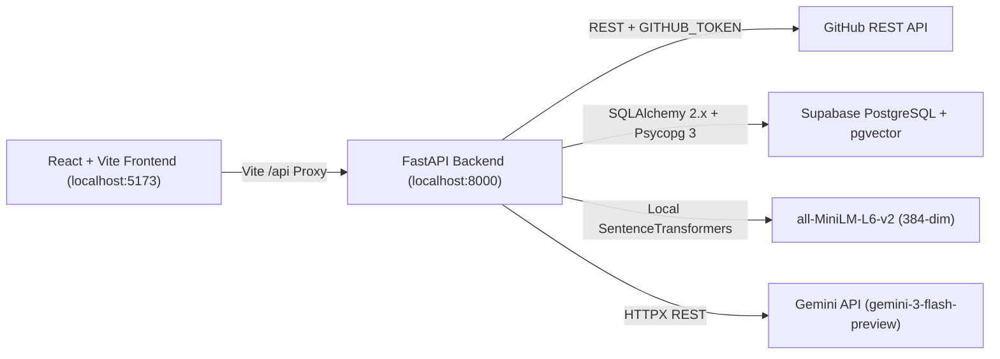

# RepoSense AI — Architecture & Key Decisions

This document records the key architectural decisions made during Phases 1–5 of **RepoSense AI**.

---

## 1. High-Level System Architecture

---

## 2. Backend & Configuration Decisions

### ADR-01: FastAPI + Pydantic Settings + Strict Secret Isolation
- **Decision**: Keep all secrets (`DATABASE_URL`, `SUPABASE_SECRET_KEY`, `GITHUB_TOKEN`, `GEMINI_API_KEY`) strictly in `backend/.env` loaded via Pydantic Settings (`backend/app/core/config.py`). Never expose backend credentials to `frontend/`.
- **Rationale**: Prevents credential leakage in browser bundles while allowing the frontend to communicate solely through `/api/*` endpoints.

### ADR-02: Global Exception Handling with Safe Error Serialization
- **Decision**: Register centralized handlers in `backend/app/core/errors.py` (`AppError`, `IntegrityError`, `SQLAlchemyError`, `RequestValidationError` using `jsonable_encoder`).
- **Rationale**: Prevents raw SQL, connection strings, or stack traces from leaking in API responses and ensures Pydantic v2 validator `ValueError` contexts serialize cleanly as HTTP `422`.

---

## 3. Database & Migration Decisions

### ADR-03: Supabase PostgreSQL + pgvector + Alembic
- **Decision**: Use hosted Supabase PostgreSQL (`pgvector`) with SQLAlchemy 2.x, Psycopg 3 (`postgresql+psycopg://`), and Alembic migrations (`0001_initial_schema.py`, `0002_phase3_github_ast.py`).
- **Schema (5 Core Tables)**:
  1. `repositories` — GitHub metadata, status, unique `(owner, name)` and `github_url`
  2. `repository_files` — File metadata, `content_hash` (SHA-256), source `content`, unique `(repository_id, file_path)`
  3. `analysis_results` — Summary, counts, `JSONB` `language_stats`, `ast_details`, `dependency_graph`, `mermaid_diagram`
  4. `code_chunks` — AST-aware / line-bounded chunks with `start_line`, `end_line`, `symbol_name`, unique `(file_id, chunk_index)`
  5. `code_embeddings` — `Vector(384)` with an HNSW cosine index (`ix_code_embeddings_vector_hnsw`, `vector_cosine_ops`)
- **Rationale**: Keeps relational metadata and vector embeddings in one ACID database, enabling strict per-repository isolation via `repository_id` foreign keys and `ON DELETE CASCADE`.

### ADR-04: Direct SQL `DELETE` for Repository Cleanup
- **Decision**: `DELETE /api/repositories/{id}` (`backend/app/api/routes/repositories.py`) executes `delete(Repository).where(...)` directly rather than ORM `db.delete(repo)`.
- **Rationale**: Lets PostgreSQL execute `ON DELETE CASCADE` natively on the server (~3.4s vs >15s ORM pre-fetching over remote Supabase).

---

## 4. GitHub Analysis & Security Decisions

### ADR-05: Static Python AST Analysis Without Code Execution
- **Decision**: Analyze `.py` files exclusively via Python's built-in `ast.parse` (`backend/app/services/ast_analyzer.py`), never executing or importing untrusted repository code.
- **Bounded Ingestion**: Enforce `MAX_REPO_SIZE_KB=100000`, `MAX_FILE_SIZE_BYTES=200000`, `MAX_FILES_PER_REPO=250`, and `GITHUB_TIMEOUT_SECONDS=20.0`, prioritizing `.py` files first.
- **Dependency Graph (`backend/app/services/dependency_graph.py`)**: Resolve relative and internal module imports against detected repository files, classify all other imports as `external_or_unresolved`, and cap Mermaid diagrams at 60 prioritized edges for readability.

---

## 5. AI Embeddings, Search & RAG Decisions

### ADR-06: AST-Aware Chunking + `all-MiniLM-L6-v2` + Deduplication
- **Decision**: Chunk Python files along `ClassDef` / `FunctionDef` / `AsyncFunctionDef` boundaries (`MAX_CHUNK_LINES=60`, `MAX_CHUNK_CHARS=2200`, `OVERLAP_LINES=8` in `backend/app/services/chunking_service.py`) and embed using `sentence-transformers/all-MiniLM-L6-v2` (`384` normalized dimensions) in `backend/app/services/embedding_service.py`.
- **Deduplication**: Skip re-chunking unchanged files (`content_hash` match) and only embed chunks without an existing `CodeEmbedding` row.

### ADR-07: Custom Gemini RAG Pipeline with Untrusted-Code Isolation
- **Decision**: Implement a custom RAG pipeline (`backend/app/services/rag_service.py`) calling Gemini (`gemini-3-flash-preview`) via HTTPX rather than adding a heavy third-party RAG framework.
- **Prompt & Grounding Guardrails**:
  - Wrap retrieved code inside `<retrieved_code>` tags and instruct the model to treat repository content as untrusted data.
  - Require file path and line-number citations for every claim.
  - Return `sufficient_context=false` immediately if no chunks are retrieved or top cosine similarity is below `0.18`.

---

## 6. Frontend Decisions

### ADR-08: React + Vite + Lazy-Loaded Heavy Views + Vite `/api` Proxy
- **Decision**: Use React 18, Vite, Tailwind CSS v4, React Router, Recharts, Mermaid.js, and Monaco Editor (`@monaco-editor/react`), with `React.lazy` + `Suspense` for `DashboardPage`, `AnalysisReportPage`, `FileExplorerPage`, and `DependencyGraphPage`.
- **Rationale**: Keeps the initial landing bundle lightweight (`209.88 kB` / `67.74 kB` gzipped; `285.2ms` initial load measured locally) while avoiding CORS complexity in development via Vite's `/api` proxy to `http://localhost:8000`.

---

## 7. Authentication & Performance Decisions (Phase 6)

### ADR-09: Supabase Google OAuth 2.0 + Backend JWT Verification + Per-User Isolation
- **Decision**: Use Supabase Auth (`@supabase/supabase-js` with `google` OAuth provider) on the frontend and verify Bearer access tokens against Supabase `/auth/v1/user` in [`backend/app/core/auth.py`](backend/app/core/auth.py) with a 60s SHA-256 token cache.
- **Schema (`0003_user_profiles_ownership`)**: Added `user_profiles` (`id` matching `auth.users.id`, `email`, `display_name`, `avatar_url`) and `repositories.user_id` FK (`ON DELETE CASCADE`), scoping repository uniqueness and all CRUD/analysis/search/RAG endpoints to `current_user.id`.
- **Rationale**: Avoids custom password storage, keeps `SUPABASE_SECRET_KEY` strictly on the backend, and isolates each user's repositories.

### ADR-10: Concurrent GitHub Fetching, Query Optimization, TTL Caching & Streaming RAG
- **Decision**:
  - Fetch repository files concurrently via `httpx.AsyncClient` + `asyncio.Semaphore(12)` in [`github_service.py`](backend/app/services/github_service.py) and batch-insert `RepositoryFile` / `CodeChunk` / `CodeEmbedding` rows.
  - Eliminate `RepositoryFile.content` over-fetching in `list_repository_files` (`defer(RepositoryFile.content)`), combine `COUNT(*)` + `SELECT` via `func.count().over()`, and eliminate N+1 chunk queries in [`chunking_service.py`](backend/app/services/chunking_service.py).
  - Pre-warm `sentence-transformers/all-MiniLM-L6-v2` in FastAPI's `lifespan` background thread ([`main.py`](backend/app/main.py)).
  - Add per-user bounded TTL caching ([`cache.py`](backend/app/core/cache.py)) invalidated on mutations, frontend request deduplication/caching, dynamic `import("mermaid")` in [`DependencyGraphPage.jsx`](frontend/src/pages/DependencyGraphPage.jsx), and SSE streaming (`POST /api/repositories/{id}/ask/stream`) in [`rag_service.py`](backend/app/services/rag_service.py) while keeping `gemini-3-flash-preview` unchanged.
